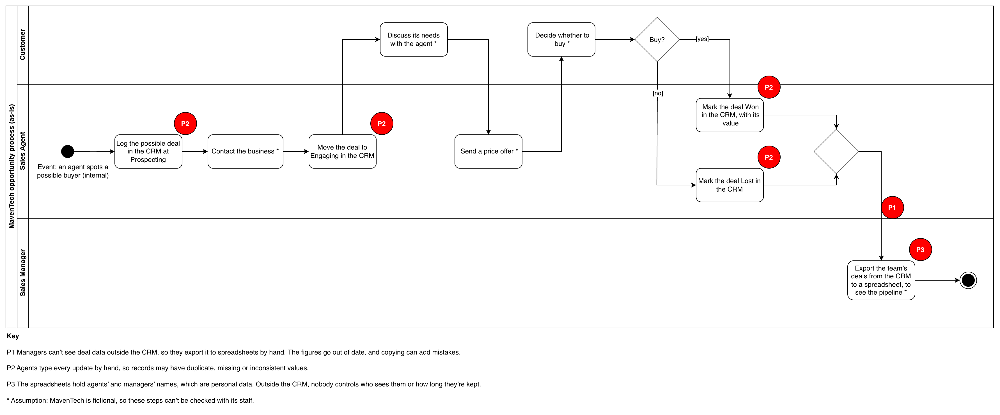

# MavenTech: As-is process map (CRM migration case study)

## About this analysis

**Portfolio case study.** MavenTech is a fictional company, and its CRM data is a public-domain practice dataset from Maven Analytics. The analysis is Varun Kumar Darbari's own work, part of the [MavenTech CRM migration case study](../README.md). MavenTech's staff can't be interviewed, so the process steps marked * are assumptions.

**Purpose.** To show how one MavenTech deal moves today, from prospecting to won or lost, and where the process goes wrong, before MavenTech moves to Salesforce.

## Key takeaway

> **Today, managers export deal data by hand and agents' typed updates may hold errors, so Salesforce must give managers live reports and check data as it's entered.**

## The as-is swimlane

This UML activity diagram with partitions (a swimlane diagram) shows who does each activity in one deal. Red circles mark where the problems happen, and * marks an assumption. Click the diagram to open it full size.

Drawn by Varun Kumar Darbari in draw.io.

## How a deal moves today

The process starts with an internal business event: a sales agent spots a large business that might buy. It ends when the deal's result reaches the sales manager's spreadsheet.

| # | Activity | Lane | Basis |
| --- | --- | --- | --- |
| 1 | Log the possible deal in the CRM at Prospecting | Sales agent | Brief: agents record deals, which start at Prospecting |
| 2 | Contact the business * | Sales agent | Assumption |
| 3 | Move the deal to Engaging in the CRM | Sales agent | Brief: Engaging is the next deal stage |
| 4 | Discuss its needs with the agent * | Customer | Assumption |
| 5 | Send a price offer * | Sales agent | Assumption |
| 6 | Decide whether to buy * | Customer | Assumption |
| 7a | [yes] Mark the deal Won in the CRM, with its value | Sales agent | Brief: deals end Won or Lost, and finance relies on deal values |
| 7b | [no] Mark the deal Lost in the CRM | Sales agent | Brief: deals end Won or Lost |
| 8 | Export the team's deals from the CRM to a spreadsheet, to see the pipeline * | Sales manager | Assumption, based on the brief's reporting objective |

**The handoffs.** One deal crosses between lanes five times. Four crossings go back and forth between the agent and the customer. The fifth, from the agent's lane into the manager's, is the weakest: the data only gets there through a manual export (P1).

## Problems found

Three problems stand out: one at a handoff and two inside tasks. P1 is the main problem in the brief, and the move to Salesforce must fix it.

| # | Where | Problem | Based on |
| --- | --- | --- | --- |
| P1 | The handoff from the sales agent to the sales manager | Managers can't see deal data outside the CRM, so they export it to spreadsheets by hand. The figures go out of date, and copying can add mistakes. | The brief's background and its reporting objective. The export itself is an assumption. |
| P2 | Activities 1, 3, 7a and 7b | Agents type every update by hand, so records may have duplicate, missing or inconsistent values. | The brief's "Clean the data on the way" objective. Data profiling will confirm it later. |
| P3 | Activity 8 | The spreadsheets hold agents' and managers' names, which are personal data. Outside the CRM, nobody controls who sees them or how long they're kept. | The brief's note on personal data, and the data protection lead's role in the stakeholder analysis |

## Assumptions

MavenTech is fictional, so these points couldn't be checked with its staff.

- **The trigger.** A deal starts when a sales agent spots a possible buyer, an internal event. Deals in the data start at Prospecting, before any engagement, so the agent finds the business first.
- **The sales steps.** Contacting the business, discussing its needs, sending a price offer and the customer's decision (activities 2, 4, 5 and 6) are typical business-to-business sales steps.
- **The export.** One of the brief's objectives is that managers can produce reports "without exporting data", which suggests they export data today (activity 8).
- **The deal stages.** Maven Analytics lists the stages (Prospecting, Engaging, Won, Lost) but doesn't define them. Their meanings here are this analysis's interpretation.

## Sources

- [BCS Foundation Certificate in Business Analysis syllabus v4.1](https://www.bcs.org/media/e3fllbw3/ba-foundation-syllabus.pdf): learning outcomes 7.3 (business events and swimlane diagrams) and 7.5 (the as-is process model)
- [MavenTech CRM migration: project brief](01-project-brief.md): scope, objectives, stakeholders and personal data
- [MavenTech: Stakeholder analysis](03-stakeholder-analysis.md): each role's part in the project
- [Maven Analytics: deal pipeline stages](https://mavenanalytics.io/project/13846): "Prospecting > Engaging > Won / Lost"
