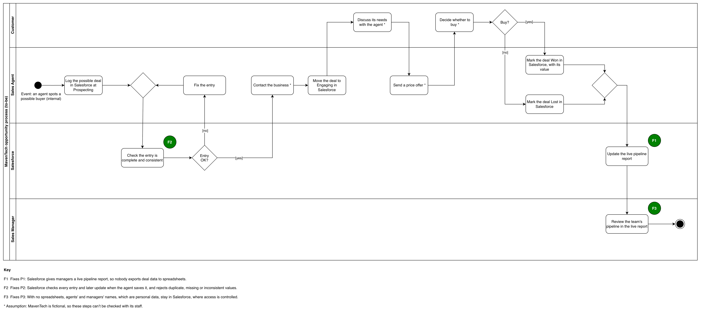

# MavenTech: To-be process map and gap analysis (CRM migration case study)

## About this analysis

**Portfolio case study.** MavenTech is a fictional company, and its CRM data is a public-domain practice dataset from Maven Analytics. The analysis is Varun Kumar Darbari's own work, part of the [MavenTech CRM migration case study](../README.md). MavenTech's staff can't be interviewed, so the process steps marked * are assumptions, carried over unchanged from the [as-is map](04-as-is-process-map.md).

**Purpose.** To show how one MavenTech deal will move once Salesforce is in place, how that fixes the three problems found in the as-is map, and what must change to get there.

## Key takeaway

> **Salesforce will check every update and give managers live reports, so nobody exports data by hand; getting there needs training, clean data and GDPR records for personal data.**

## The to-be swimlane

This UML activity diagram with partitions (a swimlane diagram) shows who does each activity in one deal once Salesforce is in place. Salesforce gets its own lane because it takes over work that people did by hand. Green circles mark the fixes, and * marks an assumption. Click the diagram to open it full size.

Drawn by Varun Kumar Darbari in draw.io.

## How a deal will move

The process starts with the same internal business event as today: a sales agent spots a large business that might buy. It ends when the sales manager reviews the deal's result in the live report.

| # | Activity | Lane | Change from the as-is map |
| --- | --- | --- | --- |
| 1 | Log the possible deal in Salesforce at Prospecting | Sales agent | Same step, now in Salesforce (was 1) |
| 2 | Check the entry is complete and consistent | Salesforce | New (F2) |
| 3 | [no] Fix the entry, then go back to the check | Sales agent | New (F2) |
| 4 | [yes] Contact the business * | Sales agent | Unchanged (was 2) |
| 5 | Move the deal to Engaging in Salesforce | Sales agent | Same step, now in Salesforce (was 3) |
| 6 | Discuss its needs with the agent * | Customer | Unchanged (was 4) |
| 7 | Send a price offer * | Sales agent | Unchanged (was 5) |
| 8 | Decide whether to buy * | Customer | Unchanged (was 6) |
| 9a | [yes] Mark the deal Won in Salesforce, with its value | Sales agent | Same step, now in Salesforce (was 7a) |
| 9b | [no] Mark the deal Lost in Salesforce | Sales agent | Same step, now in Salesforce (was 7b) |
| 10 | Update the live pipeline report | Salesforce | New (F1) |
| 11 | Review the team's pipeline in the live report | Sales manager | Replaces the manual export, activity 8 (F1, F3) |

**Every update is checked.** Salesforce runs the same check whenever the agent saves activities 5, 9a and 9b. The map shows the check once, after activity 1, so it stays readable.

**The handoffs.** One deal now crosses between lanes eight times, three more than today. The extra crossings all run through Salesforce and happen automatically, and the manual handoff from agent to manager is gone.

## What changed and why

Each fix answers one problem found in the as-is map.

| Fix | What changes | Problem fixed | Improvement approach |
| --- | --- | --- | --- |
| F1 | Salesforce updates a live pipeline report, and the sales manager reviews it there. The manual export step is gone. | P1: managers export deal data by hand | Automate processing and simplification |
| F2 | Salesforce checks every entry and later update when the agent saves it, and rejects duplicate, missing or inconsistent values. The agent fixes anything it rejects. | P2: typed updates may hold errors | Automate processing |
| F3 | With no export, no spreadsheets get made, so agents' and managers' names, which are personal data, stay in Salesforce, where access is controlled. | P3: personal data sits in spreadsheets | Simplification |

BCS says improvement approaches "may be applied individually or in combination for the best outcome." F1 uses two, and the export step it removes also fixes P3.

## Gap analysis

The gap analysis compares the current state, shown in the as-is map, with the target state, shown in the to-be map. It goes one POPIT area at a time: people, organisation, process, information and technology.

| Area | Current state | Target state | Gap: what must change |
| --- | --- | --- | --- |
| People | Agents and managers are trained on the current CRM only | Agents can save and fix deal entries in Salesforce, managers can use its reports, and the CRM administrator can run it | Train agents to save and fix entries, managers to use live reports, and the CRM administrator to run Salesforce |
| Organisation | The CRM administrator looks after the current CRM's settings and data quality | The CRM administrator's job covers Salesforce's entry checks, reports and user access | Expand the CRM administrator's job to run Salesforce's entry checks, reports and user access |
| Process | Managers export deals by hand to see the pipeline, and no step checks agents' updates | No export step, and every update goes through a check-and-fix loop | Remove the manual export step, and add a check-and-fix loop to every deal update |
| Information | Values may be duplicate, missing or inconsistent, and agents' and managers' names are copied into spreadsheets | One clean copy of the data in Salesforce, and every personal-data field has a recorded purpose, lawful basis and retention rule | Clean duplicate, missing and inconsistent values during the move, delete the old spreadsheets, and record each personal-data field's purpose, lawful basis and retention rule |
| Technology | The current CRM, whose data managers can't see outside it | Salesforce, set up with standard configuration: entry checks, plus pipeline and team reports | Set up Salesforce, using standard configuration only, with entry checks plus pipeline and team reports |

**Training.** This case study plans the training. Delivering it is out of scope, as the [project brief](01-project-brief.md) says.

## Assumptions

MavenTech is fictional, so these points couldn't be checked with its staff.

- **The carried-over steps.** Activities 4, 6, 7 and 8 come unchanged from the as-is map, where they are assumptions.
- **The old spreadsheets.** The as-is map assumes managers export deals to spreadsheets, so this analysis assumes old spreadsheets exist and need deleting.
- **The CRM administrator.** The current administrator stays in the role and learns Salesforce, rather than MavenTech hiring someone new.
- **Standard configuration is enough.** Salesforce's standard validation rules and duplicate rules can run the entry checks, as the brief requires. Which fields they check is decided in the specification stage.

## Sources

- [BCS Foundation Certificate in Business Analysis syllabus v4.1](https://www.bcs.org/media/e3fllbw3/ba-foundation-syllabus.pdf): learning outcomes 7.3 (swimlane diagrams), 7.6 (improvement approaches), 8.1 (gap analysis) and 8.2 (POPIT)
- [BCS Foundation Certificate in Business Change syllabus v4.1](https://www.bcs.org/media/1956/ba-foundation-business-change-syllabus.pdf): learning outcome 4.1, the five POPIT areas
- [MavenTech: As-is process map](04-as-is-process-map.md): the current process and problems P1 to P3
- [MavenTech CRM migration: project brief](01-project-brief.md): objectives, scope and the standard-configuration rule
- [MavenTech: Stakeholder analysis](03-stakeholder-analysis.md): the CRM administrator's role
- [Salesforce Help: Validation Rules](https://help.salesforce.com/s/articleView?id=sf.fields_about_field_validation.htm&type=5): rules check the data "before the user can save the record"
- [Salesforce Help: Customize Duplicate Rules](https://help.salesforce.com/s/articleView?id=sf.duplicate_rules_create.htm&type=5): a duplicate rule can block a duplicate record or allow it with an alert
