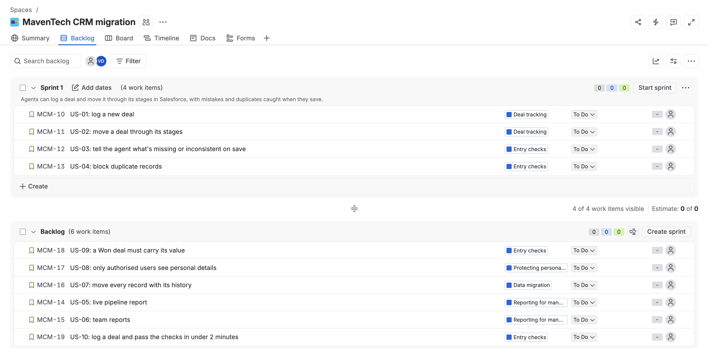
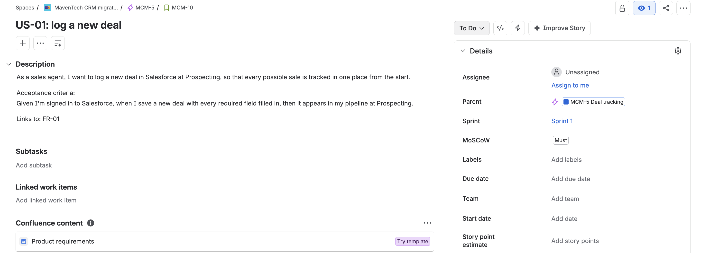

# MavenTech: Product backlog in Jira (CRM migration case study)

## About this analysis

**Portfolio case study.** MavenTech is a fictional company, and its CRM data is a public-domain practice dataset from Maven Analytics. The Jira set-up is Varun Kumar Darbari's own work, part of the [MavenTech CRM migration case study](../README.md), built in a personal Jira practice site. No sprint has run yet, so Sprint 1 is planned but not started.

**Purpose.** To put MavenTech's approved [product backlog](08-product-backlog.md) into Jira, where a Scrum team would work from it: the epics, the user stories with their acceptance criteria and priorities, the agreed order, and the Sprint 1 plan.

## Key takeaway

> **MavenTech's backlog now lives in Jira: five epics and ten ordered stories with acceptance criteria, MoSCoW and requirement links, plus Sprint 1's four stories and goal.**

## 1. How the Jira space is set up

| Setting | Choice | Why |
| --- | --- | --- |
| Template | Scrum, in a space called MavenTech CRM migration, with the key MCM | Scrum gives the team a backlog, sprints and a board |
| Space type | Team-managed | The team can change its own settings, such as adding the MoSCoW field |
| Statuses | To Do, In Progress, In Review, Done | In Review is where a built story is checked against its acceptance criteria and shown to the sales director, as the Definition of Done requires |
| Priority | A MoSCoW dropdown field on the Story work type, with Jira's Priority field removed from it | Jira's Priority runs from Highest to Lowest, while the requirements catalogue uses MoSCoW, so each story shows one priority on the catalogue's scale |

## 2. The backlog and Sprint 1

Click a screenshot to open it full size.

- **Five epics** (MCM-5 to MCM-9): Deal tracking, Entry checks, Reporting for managers, Data migration, and Protecting personal data. Each story shows its epic as a tag.
- **Ten stories** (MCM-10 to MCM-19), in the order approved in the product backlog: US-01, US-02, US-03, US-04, US-09, US-08, US-07, US-05, US-06, then US-10. Jira only changes a story's place when someone drags it, so the order was set by hand.
- **Sprint 1** holds US-01 to US-04, with its Sprint Goal shown under the name: "Agents can log a deal and move it through its stages in Salesforce, with mistakes and duplicates caught when they save." It has no dates and hasn't been started.

## 3. What each story card holds

| Part of the card | What it holds |
| --- | --- |
| Key | Jira's ID for the card, such as MCM-10 |
| Summary | The story's US number and name, such as "US-01: log a new deal", so the card traces back to the requirements catalogue |
| Description | The user story, its acceptance criteria, and the requirement it links to, such as FR-01 |
| Parent | The story's epic |
| MoSCoW | Must or Should |
| Story point estimate | Left empty, because the Developers who'll build the story size it |

Together with Jira's change history, these cover the main parts of a requirements catalogue entry in the BCS syllabus (11.2): the identifier, name, description, acceptance criteria, priority and version history.

## 4. Next steps

- **Confluence.** The BRD's first pages go into Confluence, linked to these stories.
- **Build.** The stories are built step by step in a Salesforce Trailhead Playground.
- **Testing.** Problems found in user acceptance testing will be logged in this Jira space.

## Assumptions

MavenTech is fictional, so these points couldn't be checked with its staff.

- **Practice site.** The space sits on a personal Jira practice site, so these screenshots are the record of it.
- **Planned, not started.** No sprint has run yet, so Sprint 1 has a goal but no dates, and it hasn't been started.
- **No estimates.** Sizing belongs to the Developers who'll do the work, so the story point estimates are empty.
- **One person's set-up.** A real team would agree the statuses and fields together. Here they're one analyst's choices.

## Sources

- [Atlassian Support: Use your scrum backlog](https://support.atlassian.com/jira-software-cloud/docs/use-your-scrum-backlog/): ranking stories by dragging, and creating and filling sprints
- [Atlassian Support: Manage epics in a scrum space](https://support.atlassian.com/jira-software-cloud/docs/manage-epics-in-a-scrum-project/): linking stories to epics with the Parent field
- [Atlassian Support: Customize work item fields in team-managed spaces](https://support.atlassian.com/jira-software-cloud/docs/customize-an-issues-fields-in-team-managed-projects/): adding the MoSCoW field
- [Atlassian Support: Manage priorities](https://support.atlassian.com/jira-cloud-administration/docs/configure-priorities-for-projects/): Jira's default priorities, Highest to Lowest
- [Atlassian Support: Edit a sprint](https://support.atlassian.com/jira-software-cloud/docs/edit-a-sprint-in-a-company-managed-project): a sprint's name, dates and goal
- [BCS Foundation Certificate in Business Analysis syllabus v4.1](https://www.bcs.org/media/e3fllbw3/ba-foundation-syllabus.pdf): learning outcomes 11.2 (the requirements catalogue) and 11.6 (the product backlog)
- [MavenTech: Product backlog and Sprint 1 plan](08-product-backlog.md): the epics, the order, the Sprint Goal and the Definition of Done
- [MavenTech: Requirements catalogue and user stories](07-requirements-catalogue.md): the stories, their acceptance criteria and the requirements they link to
