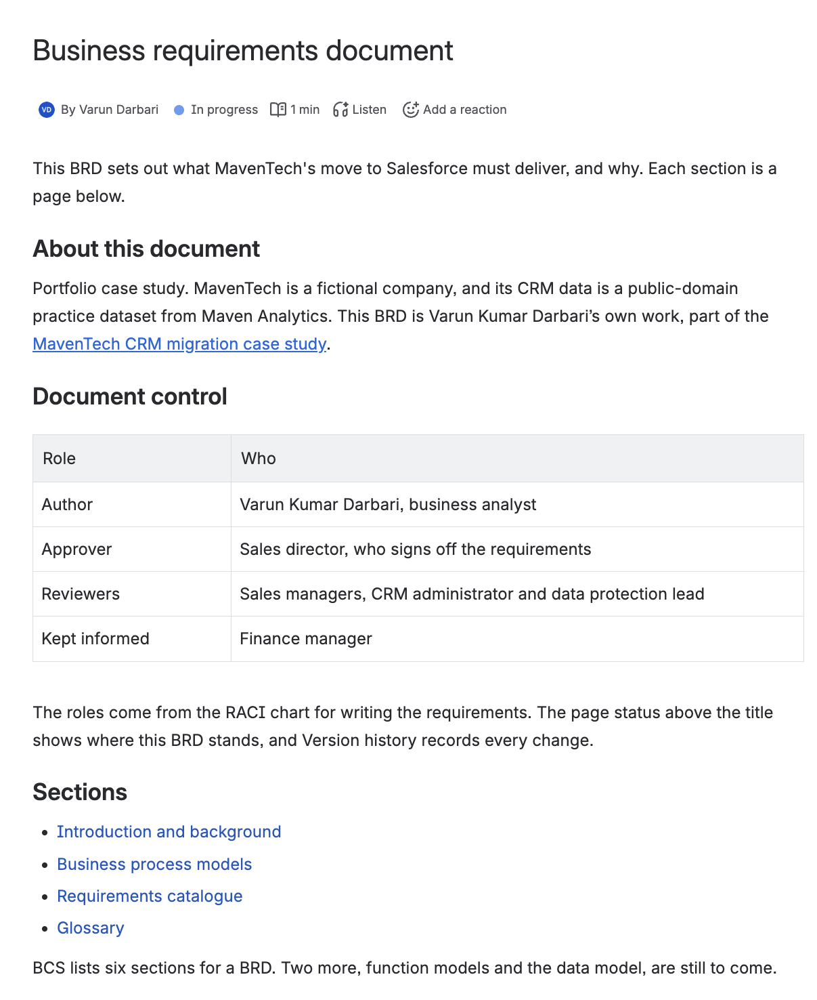
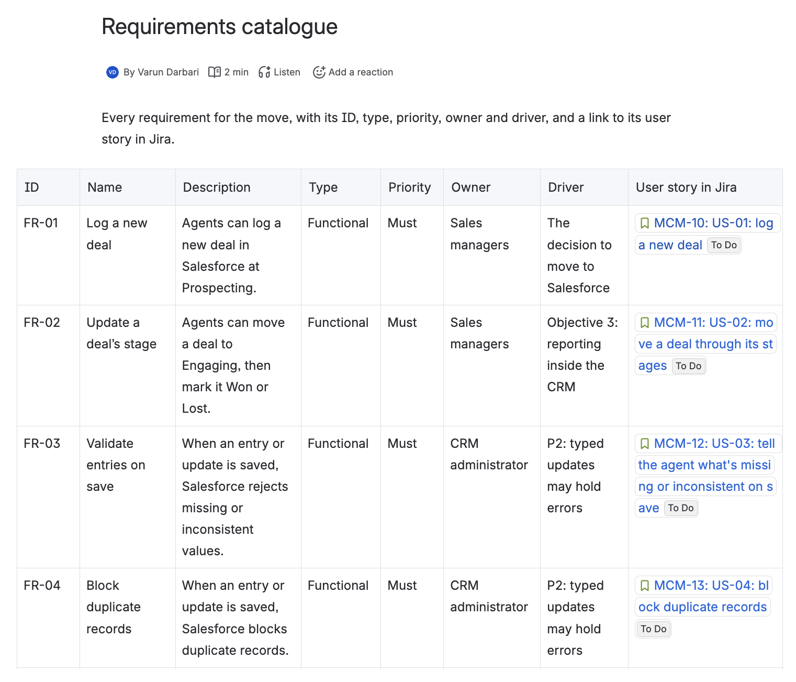
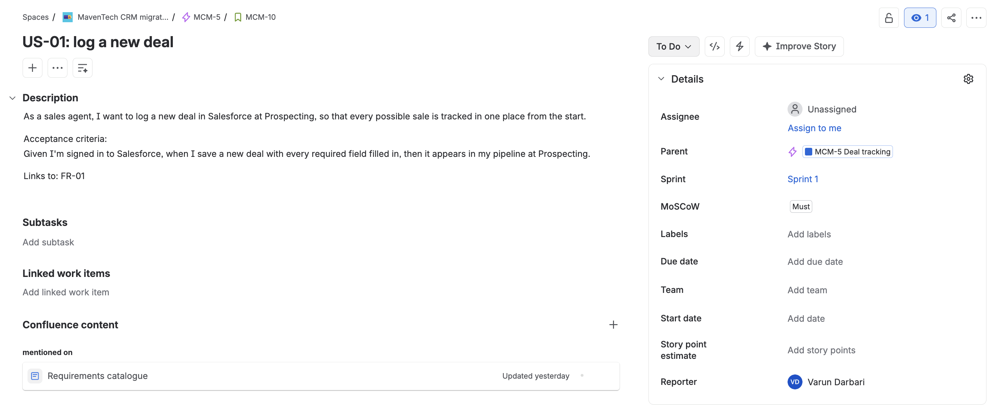

# MavenTech: Business requirements document in Confluence (CRM migration case study)

## About this analysis

**Portfolio case study.** MavenTech is a fictional company, and its CRM data is a public-domain practice dataset from Maven Analytics. The Confluence pages are Varun Kumar Darbari's own work, part of the [MavenTech CRM migration case study](../README.md), built in a personal Confluence practice site.

**Purpose.** To start MavenTech's business requirements document (BRD) in Confluence, where the people who review and approve it can read it, and to link its requirements to the user stories in [Jira](09-jira-backlog.md), so each can be traced to the other. BCS places a BRD in waterfall or linear projects and a product backlog in Agile ones, so keeping both, linked, means MavenTech's requirements suit either way of working.

## Key takeaway

> **MavenTech's BRD now lives in Confluence: four of the six BCS sections, including a 26-term glossary, with requirements and Jira stories linked both ways.**

## 1. How the BRD is set up

| Setting | Choice | Why |
| --- | --- | --- |
| Space | A Confluence space for MavenTech's business analysis documents, on the same Atlassian site as the Jira space | Pages and stories on one site can link to each other |
| Structure | A home page for the BRD, with each section as a page under it | Each section can be reviewed and updated on its own, and the home page lists them all |
| Sections | Four of the six in the BCS syllabus: introduction and background, business process models, requirements catalogue and glossary | Function models and the data model come next |
| Status | Confluence's page status, set to In progress | Anyone can see at a glance that the BRD isn't final |
| Changes | Version history, with version comments saying what changed | Every change is recorded, and an earlier version can be restored |

## 2. The BRD's home page

Click a screenshot to open it full size.

- **Document control.** The roles come from the RACI chart for writing the requirements, in the [stakeholder analysis](03-stakeholder-analysis.md). The business analyst writes the BRD (R), the sales director approves it (A), the sales managers, CRM administrator and data protection lead review it (C), and the finance manager is kept informed (I).
- **Sections.** Confluence's child items macro lists the pages under the home page, so the list updates itself when the last two sections are added.

## 3. What each section holds

| Section | What it holds | Built from |
| --- | --- | --- |
| Introduction and background | Why MavenTech is moving to Salesforce, five numbered objectives with a success measure each, and what's in and out of scope | The [project brief](01-project-brief.md) |
| Business process models | The as-is and to-be swimlane diagrams, with problems P1 to P3 and fixes F1 to F3. Each fix names the problem it fixes and the requirements that deliver it | The [as-is](04-as-is-process-map.md) and [to-be](05-to-be-process-map.md) process maps |
| Requirements catalogue | The 11 requirements, each with its ID, type, priority, owner and driver, and its user story in Jira where it has one, plus business rule BR-01. A Jira work items list shows all ten stories | The [requirements catalogue](07-requirements-catalogue.md) and the [Jira backlog](09-jira-backlog.md) |
| Glossary | 26 terms that a reader could take the wrong way, in alphabetical order, from Account to Won | New in this piece |

**How the glossary was chosen.** A term goes in if two readers could take it differently. That covers MavenTech's own terms, such as its deal stages, and everyday words with a special meaning here, such as "entry checks". Where two words mean the same thing, one is defined and the other points to it: "Opportunity: Another name for a deal. See Deal."

## 4. Requirements and Jira stories, linked both ways

- **From the catalogue to Jira.** Each user story is a Jira smart link, which shows the story's key, summary and status, such as To Do.
- **From Jira to the catalogue.** Jira lists the catalogue on each linked story, under Confluence content, as "mentioned on". US-01 is shown below.
- **Why smart links.** In a narrow column, a smart link can break mid-word. Plain web links don't, but Jira doesn't list them on the story, so the catalogue keeps its smart links, with wider columns to reduce the breaks.

## 5. Next steps

- **The last two sections.** The function model and the data model are added to the BRD.
- **Build.** The data model is built in a Salesforce Trailhead Playground.
- **The rest of the specification.** Data-quality checks with SQL, the data mapping, a GDPR data inventory, the functional requirements document (FRD), the UAT plan and the traceability matrix.

## Assumptions

MavenTech is fictional, so these points couldn't be checked with its staff.

- **Practice site.** The pages sit on a personal Confluence practice site, so these screenshots are the record of them.
- **Review and sign-off.** The document control table names who would review and approve the BRD. Because the case is fictional, that review is planned rather than held.
- **Deal stages.** Maven Analytics names the four deal stages but doesn't define them, so their meanings in the glossary are this analysis's interpretation, based on the as-is process.
- **One person's set-up.** A real team would agree the page structure together. Here it's one analyst's choice.

## Sources

- [BCS Foundation Certificate in Business Analysis syllabus v4.1](https://www.bcs.org/media/e3fllbw3/ba-foundation-syllabus.pdf): learning outcomes 11.6 (the product backlog) and 11.7 (the business requirements document)
- [Atlassian Support: Create, update, and manage written content](https://support.atlassian.com/confluence-cloud/docs/create-edit-and-publish-a-page/): version comments, version history and restoring an earlier version
- [Atlassian Support: Add a status to your content](https://support.atlassian.com/confluence-cloud/docs/add-a-status-to-your-page-or-blog/): page statuses such as In progress
- [Atlassian Support: Insert the child items macro](https://support.atlassian.com/confluence-cloud/docs/insert-the-children-display-macro/): a list of the pages under a page that updates itself
- [Atlassian Support: Display Jira work items in a list](https://support.atlassian.com/confluence-cloud/docs/insert-the-jira-issues-macro/): the Jira work items list
- [Atlassian Support: Use Jira and Confluence together](https://support.atlassian.com/confluence-cloud/docs/use-jira-and-confluence-together/): linking Jira work items and Confluence pages, and seeing their status
- [MavenTech CRM migration: project brief](01-project-brief.md): the background, objectives and scope
- [MavenTech: Stakeholder analysis](03-stakeholder-analysis.md): the RACI chart behind the document control
- [MavenTech: As-is process map](04-as-is-process-map.md) and [To-be process map and gap analysis](05-to-be-process-map.md): the problems, the fixes and both diagrams
- [MavenTech: Requirements catalogue and user stories](07-requirements-catalogue.md): the 11 requirements and BR-01
- [MavenTech: Product backlog in Jira](09-jira-backlog.md): the ten stories the catalogue links to
